# Getting started

[Back to the README](../README.md)

## Who this release is for

> **v0.3.2 is aimed at hands-on users.** The packed repack remains the default
> described in this guide. The virtual repack reads experts in place and remains an
> opt-in preview, chosen in the `repack` row of the model's settings on 1 Models; it has not
> passed the performance gate.

You are comfortable downloading a GGUF from Hugging Face, you have an NVMe SSD and the patience
for a one-time repack, and you want to run MoE models your RAM says you cannot. If that is you,
this release is built for you and you should be able to follow it end to end. We hope it helps
you put AI to work.

If you are looking for an app that finds, downloads and chats with a model for you, this is not
that, and pretending otherwise would waste your evening. MoE-Direct has no model download feature
today: you bring your own GGUF. It is a serving engine that runs the model, not a chat app, so if
you came expecting a place to talk with an AI, it will not meet that expectation. We ask for your
understanding.

## Before you start

**You need, before anything else:**

| | Requirement | Notes |
|---|---|---|
| OS | Windows 10 or 11, x64 | Windows only in v0.3.2. No Linux/macOS build exists; see [FAQ](faq.md#faq). |
| Runtime | Microsoft Visual C++ Redistributable (x64) | The engine binaries are built with MSVC. Most machines already have it; if it is missing the server cannot start (see [`fail_server_start`](troubleshooting.md#fail_server_start)). Install it from Microsoft's [Latest supported Visual C++ Redistributable downloads](https://learn.microsoft.com/en-us/cpp/windows/latest-supported-vc-redist) page. |
| Storage | An NVMe SSD | This design is I/O bound by construction. Other storage - a SATA SSD, an external drive - is **not validated and not recommended**: the launcher does not block it, it measures your drive and reports the throughput it found. |
| Model | It must be GGUF. Pinned catalog models are the validated path; an unlisted GGUF is accepted only when its architecture has a shipped template, and it runs labelled `experimental`. | Exact repos and revisions in [Supported models](models.md#supported-models). |
| Disk | About **2x the model size**, plus reserve, on the default packed path | The packed repack writes its output next to your GGUF and the original stays. Nothing is deleted. The opt-in virtual repack writes a manifest and its plan report (measured at about 6 MB for the 122B test model and about 16 MB for the 397B one) and moves no expert data. |
| Time | **Minutes to roughly 18 minutes on the recorded machine, once per model** | Recorded there: 61 GB store in 130 s, 72.8 GB in 220 s, 436 GB in 18 min. Another drive may take longer. Before a model's first repack the launcher shows `first repack: not known yet` as the time, and while the repack runs it shows a live progress bar. |
| RAM | Enough for the cache budget the launcher picks | The launcher sizes the expert cache from your installed RAM and the model's slot geometry, between 4 GB and 12 GB, and you can override it in the `RAM budget` row of the model's settings. Each profile also has a minimum below which it cannot be served at all: 8 GB for the 122B, 397B, gpt-oss and DeepSeek profiles, 4 GB for the 35B, 10 GB for K2.6. On a first run the sizing needs the slot geometry that the repack produces, so it happens after the repack and its verification; the preflight that runs before any repack output is written checks the explicit or profile-minimum budget instead. The 4 GB to 12 GB range is what the launcher picks by itself; the range the `RAM budget` row shows, 8 GB to 64 GB for the 122B model, is what you may set by hand. |
| Python | Not needed | A pinned CPython runtime for the repacker is included in the zip. |

**Windows will warn you.** v0.x is an *unsigned* public preview, so SmartScreen showing
"Windows protected your PC" is the expected outcome for a new unsigned file, not a sign that
something is wrong with your download - verify the SHA-256 and decide for yourself. On managed
PCs, or with Smart App Control enabled, the file may be blocked outright with no "Run anyway"
option; Smart App Control has no per-app exception. We will never ask you to turn off Defender,
SmartScreen or Smart App Control, to add antivirus exclusions, to change your machine-wide
execution policy, or to run anything as administrator. Code signing is planned. It has not
happened yet - the project applies as its visibility grows - so unsigned-preview warnings remain
the expected experience for now.

## Quick start

**Step 0 - get the right file.** On the Releases page, download these **two maintainer-provided
files** (GitHub also shows two automatically generated "Source code" archives - ignore those;
they contain no binaries):

| Asset | What it is |
|---|---|
| `moe-direct-v0.3.2-win-x64.zip` | The runtime bundle. This is the one you want. |
| `SHA256SUMS.txt` | The checksum of that zip. |

**Then, in this order.** The order matters: Windows marks downloaded files, and unblocking the zip
*after* extracting does not clean up the files that were already extracted.

1. **Verify the download.** In Explorer, open the folder that holds both downloaded files,
   right-click empty space > Open in Terminal (PowerShell), then paste:
   ```powershell
   $zip = 'moe-direct-v0.3.2-win-x64.zip'
   $pattern = '^([0-9a-fA-F]{64})[ \t]+\*?' + [regex]::Escape($zip) + '$'
   $rows = @(Get-Content -LiteralPath '.\SHA256SUMS.txt' -ErrorAction Stop |
       Where-Object { $_ -match $pattern })
   if ($rows.Count -ne 1) { throw 'Checksum entry missing or duplicated.' }
   $expected = ($rows[0] -split '\s+')[0]
   $actual = (Get-FileHash -LiteralPath (Join-Path (Get-Location) $zip) -Algorithm SHA256 -ErrorAction Stop).Hash
   if ($actual -ne $expected) { throw 'MISMATCH: download again' }
   'OK: hash matches'
   ```
   On `MISMATCH`, stop and download again. If you skip it, the launcher's own sealed-manifest
   check still catches files changed or corrupted **inside the extracted bundle** on every start
   - what it cannot do is check the zip you just downloaded against the published checksum;
   that is what this paste is for. A checksum from the same page proves the download is intact,
   not who published it. The Windows executables are unsigned. Windows code signing is
   separate from GitHub release artifact attestations; check the release notes for the
   verification evidence published with this release.
2. **Unblock the zip itself** - right-click `moe-direct-v0.3.2-win-x64.zip` -> Properties -> tick
   **Unblock** -> OK. (Equivalent: `Unblock-File .\moe-direct-v0.3.2-win-x64.zip`.) If the
   **Unblock** checkbox is not there, the file was never marked - carry on. If a managed policy
   or Smart App Control offers no continuation, do not disable system-wide protection; wait for
   a signed build or use another machine.
3. **Extract with Windows "Extract All"** into a **new, empty** folder, for example
   `C:\moe-direct\v0.3.2\`. Other archivers differ in how they propagate the mark-of-the-web, so
   this is the one path we document.
4. **Put your GGUF somewhere the launcher can find it.** The launcher lists, without being told,
   the GGUF files under `<drive>:\moe-models\` up to three levels deep, e.g.
   `D:\moe-models\qwen3.5-122b\<repo-name>\model-00001-of-00002.gguf`. A model kept anywhere else
   is listed once you add its folder: open **5 Settings** and choose **+ add a folder** (key `a`).
   Multi-shard models must have all their shards in one folder. The folders are read again every
   5 seconds while you are on 1 Models, so a model you copy in later appears without a restart.

   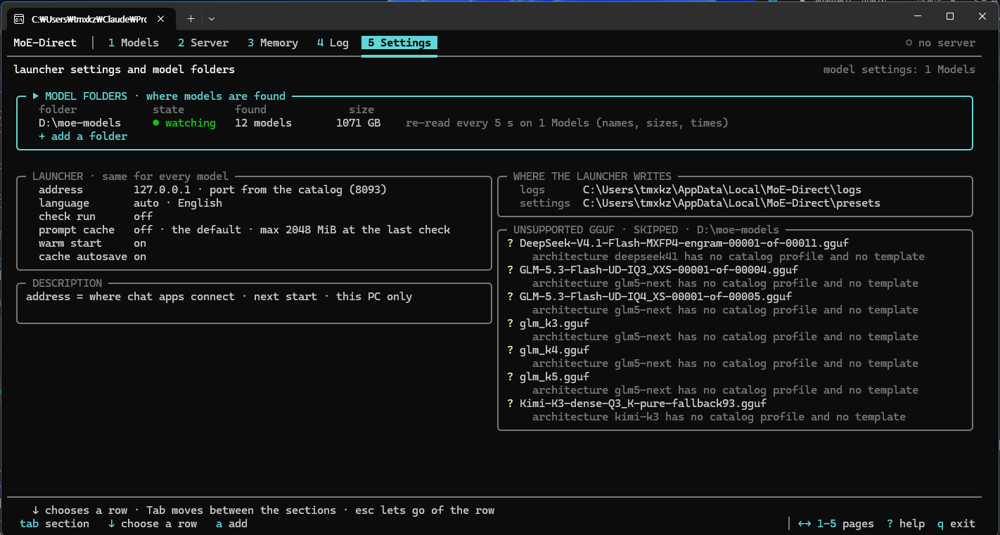
   *5 Settings: the folders the launcher reads models from, and where it writes its own files.*

   1. **MODEL FOLDERS** - each folder the launcher watches, how many models it found there and
      their size. **+ add a folder** adds one.
   2. **LAUNCHER** - the settings that are the same for every model: the address, language,
      check run, prompt cache, warm start and cache autosave.
   3. **WHERE THE LAUNCHER WRITES** - the folders for its logs and for your saved settings.
   4. **UNSUPPORTED GGUF · SKIPPED** - files it found and will not run, each with the reason.

5. **Double-click `MoE-Direct-launcher.exe`** in the extracted folder. It is the launcher: one
   program, built from the Go source in this repository's `launcher/` folder. It needs no
   PowerShell, changes no execution policy and installs nothing. It is not signed yet, so Windows
   may show a warning before it starts. Started from an open console with `-model <file.gguf>`,
   it runs without its screen (the argument-driven mode; `-h` lists the arguments).

   The extracted folder holds `MoE-Direct-launcher.exe` and `models.json` at the top, next to
   `llama-server.exe`, the fit-params pair (`llama-fit-params.exe`, `llama-fit-params-impl.dll`)
   and the engine DLLs, with `expects\` and `repacker\` as subfolders. `bundle_manifest.json`
   lists every file with its SHA-256, and the launcher checks the folder against it at every start.

   The launcher opens on **1 Models**. Its pages are named along the top - 1 Models, 2 Server,
   3 Memory, 4 Log, 5 Settings - and `←` `→` or the number keys move between them. `?` shows the
   keys of every page.

   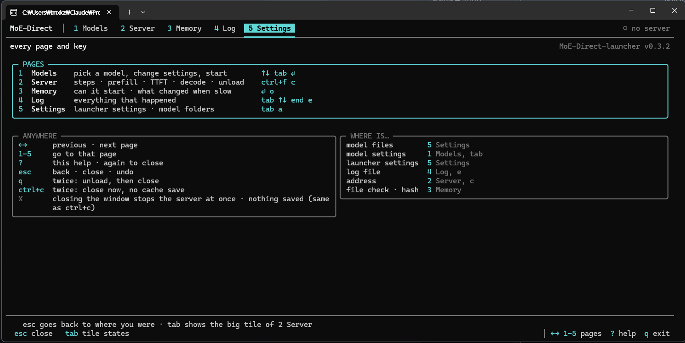
   *`?`: every page and key on one screen; `esc` closes it.*

   1. **PAGES** - what each page is for and the keys it takes.
   2. **ANYWHERE** - the keys that work on every page, and what closing the window does.
   3. **WHERE IS…** - the page that holds the model files, the model settings, the launcher
      settings, the log file, the address and the file check.

   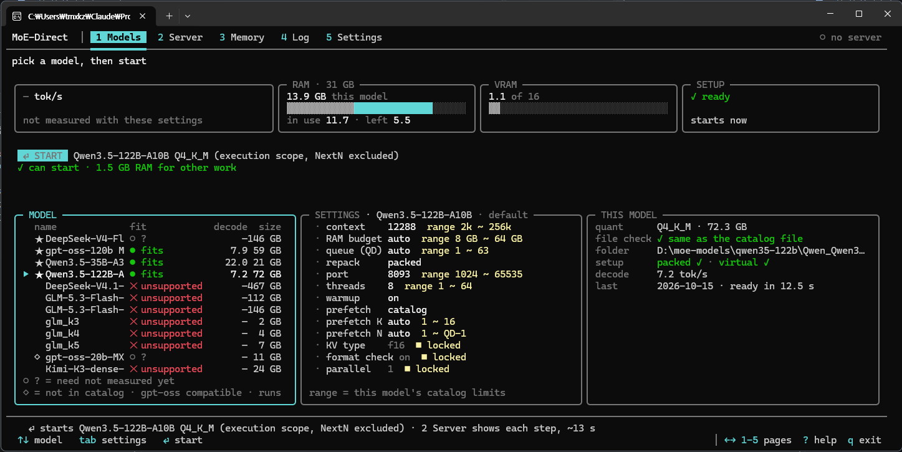
   *1 Models: pick a model, check the settings it will start with, and start it.*

   1. **MODEL** - the models the launcher found.
   2. **SETTINGS** - the settings the selected model will start with.
   3. **THIS MODEL** - the selected file and what is already known about it.
   4. The tiles across the top - the decode speed measured with these settings, the RAM and VRAM
      it will use, and whether it needs a setup (`SETUP`).
   5. **START** - the model that Enter (⏎) starts, with a line underneath that says how much
      memory stays free for other work.

   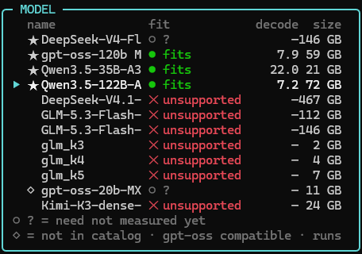

   **MODEL.** `↑` `↓` picks a model. `★` marks a model the catalog describes; `◇` marks one that
   is not in the catalog but whose architecture is compatible, so it runs. The `fit` column says
   whether it fits this PC: `fits`, `tight`, `?` when what it needs has not been measured yet, or
   `unsupported` when there is no catalog profile and no template for its architecture. The
   `decode` column is the decode speed the launcher has measured for it, and `size` the file
   size.

   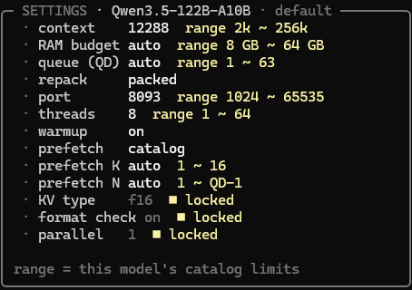

   **SETTINGS.** `tab` moves into the panel, `↑` `↓` chooses a row and `←` `→` changes it; Enter
   starts with these values and `esc` undoes. `ctrl+s` saves them for the next start, and the panel
   title then says `my settings` instead of `default`. `range` shows the limits from this model's
   catalog entry, and a row marked `locked` cannot be changed. The `repack` row chooses packed
   (the default) or virtual (the preview).

   New in v0.3.2: `queue (QD)`, `prefetch K` (1 to 16, and no more than the model's n_expert) and
   `prefetch N` can be set by hand here. For the models the catalog knows, the launcher still picks
   them itself (`auto`). A value you pick on a model that has not been checked can make things
   worse rather than better, and the launcher marks such a start
   `custom settings · performance unverified`.

   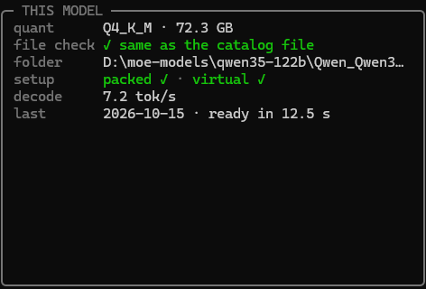

   **THIS MODEL.** The quant and size of the file, whether it is the same file the catalog pins
   (`file check`), its folder, which setup is already done (`packed ✓`, `virtual ✓`), the decode
   speed of its last run and when that run was.

6. **Approve the one-time setup.** The first time you start a model, Enter on 1 Models does not
   start the server straight away. 2 Server shows **SETUP NEEDED** with the exact cost - what the
   setup does, where it writes, how much it writes and how much free space the drive keeps
   afterwards, and the time it took last time (`first repack: not known yet` before the first
   one). Nothing is written until you press Enter (`set up and start`); `esc` goes back. If the
   drive does not have the room, the box says `cannot start` with the free and the needed sizes
   instead.

   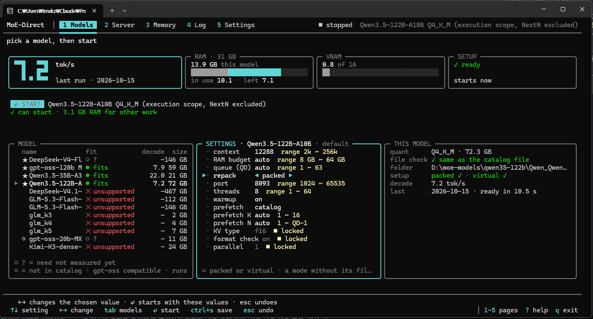
   *SETUP NEEDED: the plan for a model's first run, shown before anything is written.*

   1. **SETUP NEEDED** - the model and the repack mode it will set up (`packed`).
   2. `what to do`, `writes to`, `disk`, `time` - the cost, row by row.
   3. `then:` - what follows the repack: check, speed check, and the server starts by itself.

   Setup runs in three steps on 2 Server: **repack** rewrites the model file once so experts load
   fast, layer by layer with a live progress bar; **verify** checks what it wrote; **speed check**
   measures the drive. This is the long step: minutes to roughly 18 minutes on the recorded
   machine, depending on model size. When the three are done the server starts by itself.

   You can switch pages while setup runs; it keeps going. `ctrl+x` cancels it; a setup cancelled
   during the repack removes what it had written, so the next start begins from scratch. `q`
   twice, or closing the window, cuts setup off, and it starts over from the beginning next time:
   there is no resume. The next start after a cut-off says `an earlier setup was cut off`;
   `ctrl+r` shows the setup plan, and its Enter deletes the half-made files and redoes setup,
   while `ctrl+d` only deletes them.

   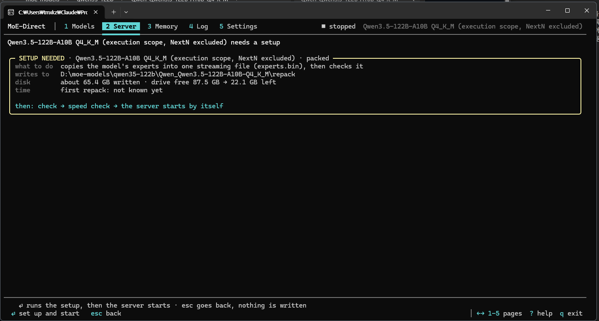
   *First-run setup at 9 %: repack is running, verify and speed check wait their turn.*

   1. The tiles - how far setup is, the time left, the disk, and the step (1 of 3).
   2. The three steps: **repack** (layers done of the total), **verify**, **speed check**.
   3. The two lines below them: setup keeps going if you switch pages; `q` twice or closing the
      window cuts it off.

   Before any start you can also look at **3 Memory**, which shows the start checklist of the
   selected model: the memory available now, what the start needs, what is left after it, and the
   Windows commit left after it. It marks one of three lines - `starts with room`,
   `starts, but tight` (apps may be paged out to disk) or `cannot start` (less available than it
   needs) - and warns when the commit left after the start is below the safe line. The launcher
   closes nothing for you; `o` opens Task Manager.

   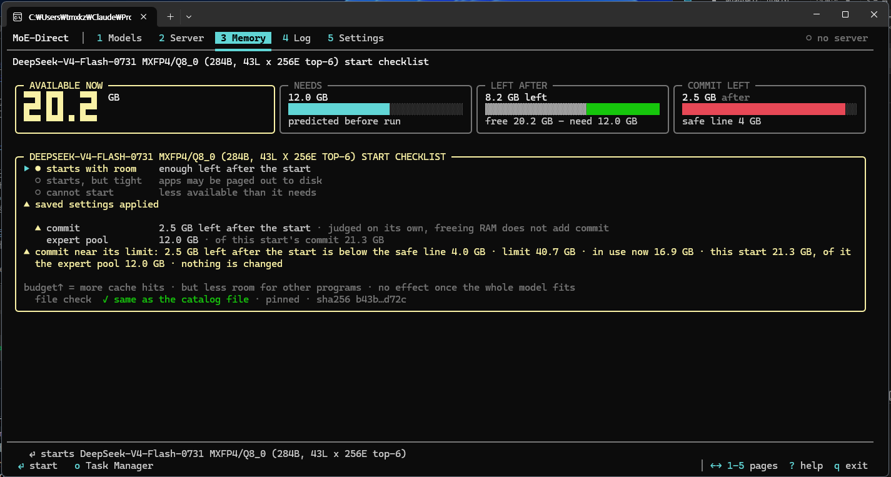
   *3 Memory before a start: the start checklist of the selected model.*

   1. **AVAILABLE NOW** · **NEEDS** · **LEFT AFTER** · **COMMIT LEFT** - the four numbers the
      checklist is built on.
   2. **START CHECKLIST** - the line that applies, any warning, and the `file check` of the model.

7. **Start the server and connect a client.** After setup the server starts by itself; on later
   runs, Enter on 1 Models starts it. 2 Server lists the **START STEPS** as they run - bundle
   check, read catalog, identify model, repack files, launcher locks, queue depth, server args,
   check memory, start server, wait /health, warm up, check run - with the time each one took.
   Check run is the response test after the start; it runs only when you turn it on in
   5 Settings. You can switch pages while the server starts, the page turns into the serving view
   by itself, and `ctrl+x` cancels the start with nothing lost.

   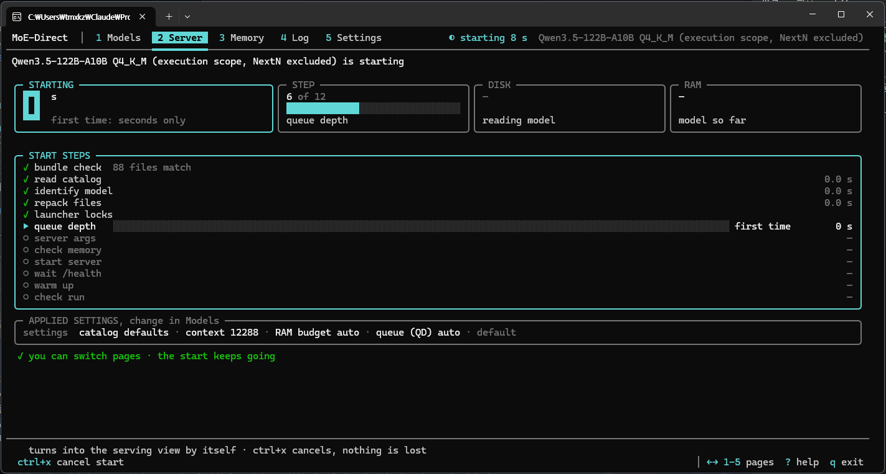
   *2 Server while the server starts: step 6 of 12, queue depth.*

   1. **STARTING** · **STEP** · **DISK** · **RAM** - elapsed time, the current step, and what the
      start has read and loaded so far.
   2. **START STEPS** - every step with its state and its time.
   3. **APPLIED SETTINGS** - the settings this start uses; you change them in 1 Models.

   When the server is up, the header says `serving` and 2 Server shows the serving view. The
   **APPLIED SETTINGS** panel gives the `address` to connect to, for example
   `http://127.0.0.1:8093/v1`, and the `API name` a client asks for; `c` copies the address.
   Connect a client (see [Connecting a client](clients.md#connecting-a-client)).

   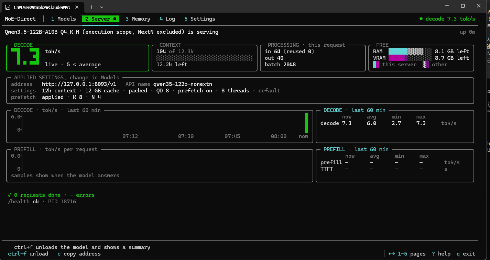
   *2 Server while serving: the live decode speed, the address to connect to, and the last hour
   of decode and prefill.*

   1. **DECODE** · **CONTEXT** · **PROCESSING** · **FREE** - the speed now, the context used, the
      request being processed, and the RAM and VRAM left.
   2. **APPLIED SETTINGS** - the address, the API name, the settings and the prefetch values in
      use.
   3. **DECODE** and **PREFILL** - the last 60 minutes, as a chart and as now, average, lowest
      and highest.
   4. The request count, the errors, and `/health`.

   **3 Memory** shows how memory is used while the model serves: the commit left, the RAM held
   by the model, by other apps, standby and free, and the VRAM of this server and of other
   programs. Apps are not closed here; `o` opens Task Manager.

   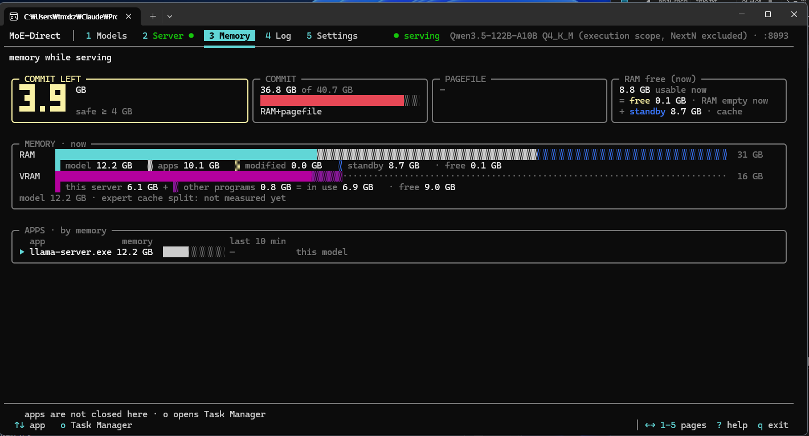
   *3 Memory while serving.*

   1. **COMMIT LEFT** · **COMMIT** · **PAGEFILE** · **RAM free (now)** - the commit and RAM
      headroom.
   2. **MEMORY · now** - RAM and VRAM, split by who holds them.
   3. **APPS · by memory** - the programs by memory, with the server marked `this model`.

Runs after the first skip the repack entirely: the launcher re-checks the existing output against
its integrity gate, re-measures the drive if it has to, and goes straight to the start steps on
2 Server.

## What success looks like

2 Server tells you, from the top, what is happening (`is starting`, `is serving`), the numbers
that matter right now, and the settings this run uses. The header carries the same state on
every page - `starting`, `serving`, `unloading`, `stopped` - so you can see it wherever you are.

**Your first conversation is usually the slowest one - by design, not by accident.** On a fresh
start the expert cache is empty and fills from the NVMe as you chat, and the first turn has to
prefill your entire prompt from that cold state: seconds for a short question, several minutes
for agent-style clients that send 15k+ token system prompts. The design already softens what it
can - the server is ready in seconds because experts are never bulk-loaded up front, and the
model is usable from the very first token. In a long-lived session that keeps a stable prompt
prefix - which is how agent-style clients behave - later turns reuse the prefix cache instead of
re-reading what was already read, and that reuse is where the multi-turn numbers in
[Measured results](measured-results.md#measured-results) come from; a turn that changes the prefix pays for the
changed part again. So judge the speed by the later turns of a session, not its first one.

Unloading the server still empties the expert cache, which fills from the NVMe again on the next
start. The prefix cache is the part that now survives: when you unload with `ctrl+f`, or quit
with `q` twice while no reply is running, the launcher saves the prompt cache first and the next
start reuses it, so the first turn of the next session does not re-prefill a prompt that was
already processed. `ctrl+c` twice, or closing the window, saves nothing. The save at a stop
needs the `warm start` row of 5 Settings; the `cache autosave` row adds a save every 5 minutes
while the server is idle. Both are on by default.
[Warm start](warm-start.md#warm-start) describes what that covers and what it does not.

**4 Log** keeps the record of what happened, newest last: the launcher's own events and the
server's output in one list, with tabs for all lines, warnings and errors. A good run has a
`ready:` line with the model, the address and how long the start took, and after a stop a
`stopped` line that ends in `ok (exit 0)`. The `logs` line at the foot of 4 Log names the log
folder, `%LOCALAPPDATA%\MoE-Direct\logs`, and the files in it; open the folder yourself in
Explorer. Pressing `e` in v0.3.2 only shows a line that starts `open-log: not ported`.

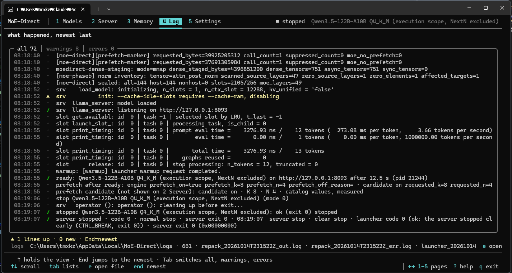
*4 Log after a run: the server's start, the `ready:` line, then a clean stop.*

1. The tabs **all** · **warnings** · **errors**, with their counts.
2. The lines, each with its time; `✓` marks the milestones and `▲` a warning.
3. The `logs` line - the log folder and the files in it.

Started with arguments from a console (`-model <file.gguf>`), the launcher draws no screen: it
prints its steps and ends with one machine-readable line on stderr,
`[moe-launcher] status=<value>`. Every status value is listed in
[Troubleshooting](troubleshooting.md#troubleshooting).

## Stopping and running again

**`ctrl+f` unloads the model and shows a summary**; the launcher stays open. 2 Server lists the
**UNLOAD STEPS**: save prompt cache, send CTRL_BREAK, wait exit (60 s), force kill, port listener
gone. The force kill runs only when the server has not exited within those 60 seconds, and the
last step confirms the port is closed. If an unload hangs, `ctrl+c` twice closes the launcher at
once, and the cache is not saved.

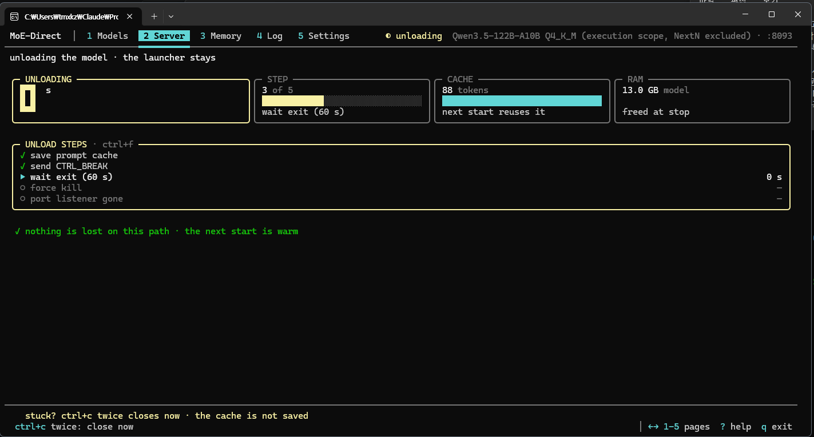
*Unloading with `ctrl+f`: step 3 of 5, the prompt cache already saved.*

1. **UNLOADING** · **STEP** · **CACHE** · **RAM** - elapsed time, the current step, the tokens of
   prompt cache the next start reuses, and the RAM freed at the stop.
2. **UNLOAD STEPS** - the five steps with their state.

When the steps are done, 2 Server shows the **run summary**: how long the server was up, the
decode and prefill averages, the time to first token (TTFT), and decode and prefill over the
whole run. Its last line says how the run ended, `ok · exit 0 · stopped` after a clean stop.
Enter starts the same model again with the same settings; to change anything, go to 1 Models.

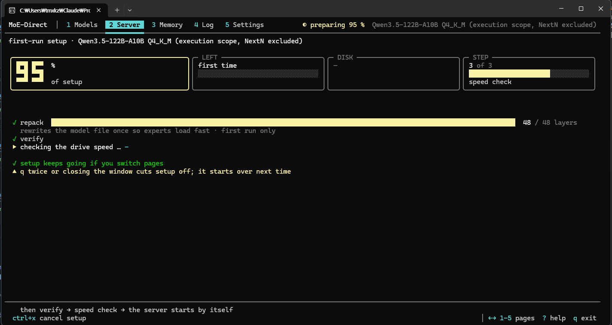
*2 Server after a stop: the run summary.*

1. The tiles - the time the server was up, **DECODE**, **PREFILL** and **TTFT**.
2. **DECODE** and **PREFILL** over the whole run.
3. How the run ended, and where the prompt cache save is recorded (4 Log).

Back on 1 Models, the model you ran shows what it did: the decode speed of its last run in the
first tile and in THIS MODEL, the date of that run and how long the server took to be ready.
Change a value in SETTINGS and press Enter to start with it, or `ctrl+s` to keep it for the next
start. While a server is running, a change applies at the next start, so unload first with
`ctrl+f`.

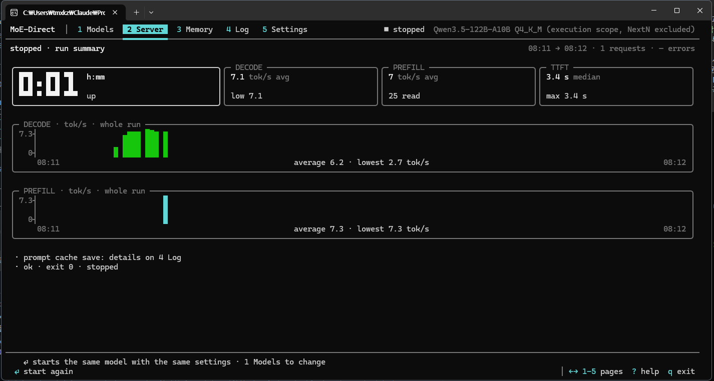
*1 Models after a run: the last run's speed, and the `repack` row chosen in SETTINGS.*

1. The first tile - the decode speed of the last run, and its date.
2. **SETTINGS** - a chosen row shows `◀` `▶`; the bottom lines list the keys for it.
3. **THIS MODEL** - `decode` and `last` now hold the run you just made.

**To close the launcher, press `q` twice.** It unloads the model, saving the prompt cache, and
exits. If a reply is still running when you press `q` the second time, it exits at once and
saves nothing. `ctrl+c` twice closes at once without saving the cache, and closing the window
does the same.

| Key | What it does |
|---|---|
| `ctrl+f` | Unload the model; the launcher stays open. |
| `ctrl+x` | Cancel a start or a setup. |
| `q` twice | Unload, then close. |
| `ctrl+c` twice | Close now, no cache save. |
| `c` | Copy the address (2 Server). |
| `←` `→` or `1`-`5` | Change page. |
| `?` | Help, the keys of every page. |

Next: [Connecting a client](clients.md)
